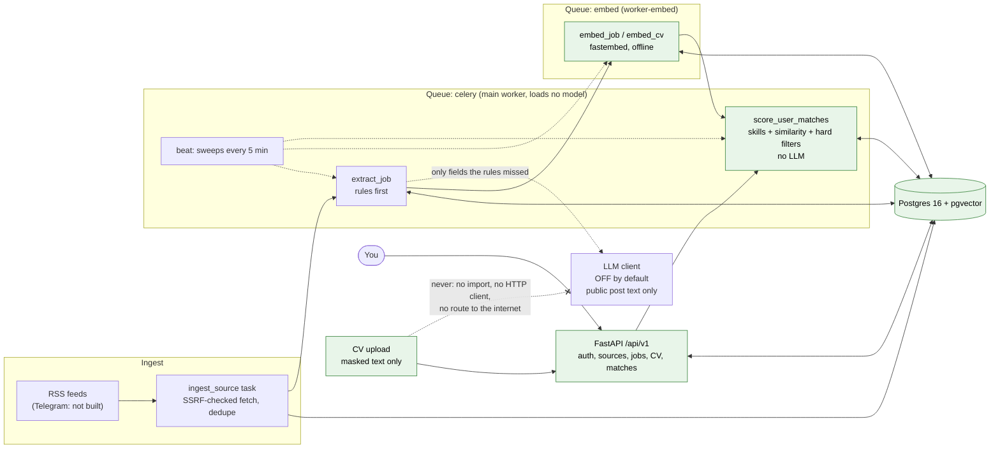

# Remote Job Radar

An AI-assisted job pipeline: it ingests remote job posts from RSS feeds, extracts structured data
(title, stack, salary, remote policy, apply contact) with **deterministic rules first and an optional
LLM only for what the rules miss**, and ranks the jobs against your CV with a score from 0 to 100
and a written explanation. The CV is processed locally and **never reaches a hosted AI provider**.

> **Measured, not claimed.**
> - Extraction: title, company, salary and seniority are 93 to 97% accurate on the **completed
>   labels** (30 hand-labelled posts), but only 13/30 posts (43.3%) have *every* field right on the
>   **first-pass labels**. The 90% target is **not met**.
> - Matching: the ranking **failed** its pre-registered test; on the evaluation pool its top 5 was
>   no better than random jobs.
>
> The two extraction numbers use different label sets on purpose and are both reported; details,
> method and limits are in [Results](#results).

This is a portfolio project, built phase by phase with tests alongside each feature. Phases 1 to 4
are done (API, auth, ingestion, extraction, CV, embeddings, matching); there is no frontend yet
([what is not built](#what-is-not-built)).

## How it works



Green boxes are the places the CV (masked text, skills, vector) can reach. The crossed dotted line
to the LLM client is enforced by code and tests, not by convention: see [Privacy](#privacy).

## What it does

- **Auth**: register and log in; access and refresh JWTs, argon2id passwords, refresh-token
  rotation with reuse detection, rate-limited auth endpoints.
- **Sources and ingestion**: RSS sources per user, fetched on a schedule or on demand. Every fetch
  and every redirect hop passes an SSRF check; bodies, entries and time are capped; posts are
  deduplicated by `source + external_id`.
- **Extraction**: a rules engine fills title, company, stack, salary (with period), seniority,
  remote policy and apply contact, with a confidence per field. A model is asked only for key
  fields the rules missed, its answer is validated and never overrides a high-confidence rule value,
  and it is **off by default** (rules only, no network).
- **LLM budgets and safety**: provider-agnostic client over REST (no vendor SDK), per-user and
  global daily request caps, a per-minute throttle, a shared cooldown after a 429 or a 503, and a
  kill switch. A provider failure leaves the job pending; it never fails it.
- **CV**: upload a PDF or text (read in a separate, killable process; the file is never stored),
  skills extracted and editable, job preferences (seniority, remote policy, minimum salary).
- **Matching**: embeddings (`bge-small-en-v1.5` via fastembed, pgvector) plus skill coverage plus
  hard filters give a 0-100 score with an explanation of what matched, what is missing and which
  filter applied. Scores are computed in the background, stored, and only read by the API.
- **Honest evaluation**: both extraction and matching were measured against fixed, written-down
  pass rules, and the results are published even though both missed.
- **Quality**: about 3,000 tests (unit and integration against a real Postgres, no real network),
  mypy strict, ruff, pre-commit, GitHub Actions.

## Tech stack

| Layer | Choice |
|---|---|
| Language, API | Python 3.12, FastAPI (async), Pydantic v2 |
| Data | PostgreSQL 16 + pgvector, SQLAlchemy 2.0 (async, typed), Alembic |
| Background work | Celery + Redis (two queues, beat for schedules) |
| Extraction | Deterministic rules, then an optional LLM over plain `httpx` (Gemini free tier; local Ollama reserved) |
| Embeddings | fastembed (ONNX, int8) running offline in its own container |
| Quality | pytest, ruff, mypy strict, pre-commit, GitHub Actions |
| Run | Docker Compose, `uv` for dependencies |

## Run it

Requirements: Docker Desktop and Git. No API key is needed.

```bash
git clone <this repository> && cd Remote-Job-Radar
cp .env.example .env          # on Windows PowerShell: Copy-Item .env.example .env
docker compose up --build
```

- **The first build is slow** (several minutes): the image bakes in the 66 MB embedding model
  (`EMBEDDING_MODEL_DOWNLOAD=1`, the Compose default). To skip the download, run
  `EMBEDDING_MODEL_DOWNLOAD=0 docker compose build` (PowerShell: `$env:EMBEDDING_MODEL_DOWNLOAD=0`
  first); the stack then runs without embeddings.
- The API is on <http://localhost:8000>, with interactive docs at <http://localhost:8000/docs>.
  The database and Redis publish no ports.
- **Embeddings and the LLM are off by default** (`EMBEDDING_PROVIDER=none`, `LLM_PROVIDER=none`,
  `LLM_EXTRACTION_ENABLED=false`). The pipeline then runs on rules and skill overlap only. Set
  `EMBEDDING_PROVIDER=fastembed` in `.env` to turn the real embeddings on. Turn the LLM on only if
  you mean to; it needs a free Gemini key and a model name you look up yourself.
- Set a real `SECRET_KEY` in `.env` for anything but a local try; in production the app refuses to
  start with the placeholder.

**Try it with invented data** (no real feed, no real CV): seed a demo account with about 20 invented
posts, then follow the PowerShell walkthrough in [docs/API_EXAMPLES.md](docs/API_EXAMPLES.md).

```bash
uv sync
uv run python -m scripts.seed_demo     # prints the demo login ONCE (a random password)
```

The script runs **from your host, not inside a container**, so the database must be reachable on
`localhost`: create the local, git-ignored `docker-compose.override.yml` that publishes the db port
and set `DATABASE_URL` to match (see [CLAUDE.md](CLAUDE.md), section 10). It writes only to a
database named `jobradar` on this machine, refuses `ENV=production`
and makes no network or provider request. `--demo-password` gives a fixed, **public** password
(`demo@example.com` / `demo-password-local-only`) for a throwaway local database only. Screenshots
and transcripts of the demo are in [docs/demo/](docs/demo/).

Development commands (tests, lint, migrations, host-run workers on Windows) are in
[CLAUDE.md](CLAUDE.md), section 10.

## Results

Both results below were measured against rules **written down before anything was labelled or
scored**, by one person on small samples. Treat them as measurements on those samples, not as
general claims.

### Extraction accuracy

30 posts from one feed, labelled blind by hand; a post "parses correctly" only if title, company,
stack (no wrong entry, at least 70% of the label found), remote policy, salary and seniority are
all right. **Target: 90%. Not met.**

| Output scored | Posts with every field right | Invented-value gate (limit 10%) |
|---|---|---|
| Stored extraction, `rules_v1` (first run) | 5/30 = 16.7% | 9/30 = 30.0% |
| Rules recomputed offline, `rules_v1` | 8/30 = 26.7% | 7/30 = 23.3% |
| Rules recomputed offline, `rules_v2` | 13/30 = 43.3% | 4/30 = 13.3% |

Per field on the completed labels (rules only): title 93.3%, company 93.3%, salary 93.3%,
seniority 96.7%, remote policy 56.7% (80.0% after `rules_v3`), stack 60.0% of posts passing.
**Why it falls short:** the pass rule needs *every* field right, so one weak field (the stack,
where the dictionary lacks 62 entries the hand labels name, and the remote policy) fails the post;
and the first run exposed real rule gaps that `rules_v2` and `rules_v3` only partly closed. The
completed labels were written after seeing the diagnosis, so the later numbers are not independent
evidence. Full tables, run records and limits: [docs/ACCURACY.md](docs/ACCURACY.md).

### Matching

Three invented personas, a frozen pool of 108 jobs, top-5 results of every method labelled blind by
one person. **Pass rule: pooled precision at 5 of at least 9/15 and strictly more than newest-first.
Verdict: FAIL.**

| Method (pooled top 5, 3 personas) | Relevant |
|---|---|
| Hybrid score (the shipped scorer) | 6/15 |
| Newest first | 4/15 |
| Pass threshold | 9/15 |
| Random jobs, for comparison | 12/30 (the same 40%) |

The score beats "newest first" but misses the threshold, and its top 5 was **as often relevant as a
random job** on this pool. The pool has a high base rate (about 4 in 10 random jobs are relevant),
there is one labeller who also built the system, and only 15 slots per method were judged, so small
differences cannot be seen. Nothing was re-tuned after seeing the result; any change would be a new
scorer version with a new protocol. Hypotheses (not findings): stub posts without a stack, the
1,800-character embedding window, dictionary gaps. Full protocol, tables and limits:
[docs/MATCHING.md](docs/MATCHING.md), sections 10 and 12.

*Note, 2026-11-24:* the demo showed three short stub posts scoring 100 for the synthetic Alex CV: the
job's whole short stack is on the CV, and the list-style stub has too few English function words to
be recognised as English, so the embedding is skipped. This is documented scorer behaviour, observed
in the demo. It is a concrete example for the hypothesis that stub posts hurt the ranking, **not a
measured cause**. A fix (for example a minimum amount of job information before a skills-only score
can be high) would be a new `SCORER_VERSION` in a separate PR with a new protocol, new sheets and new
labels.

### Method, in short

The protocol was fixed and committed **before** any label existed; labelling was blind (no rank,
score or method shown); the calibration alternative was held out; the labelling answer key is kept
apart from the sheets; the pass rule was not changed after the results; and a failing result is
published as a failure.

## Privacy

The CV is personal data, so the rule is simple: **a CV or anything derived from it never goes to a
hosted LLM provider, and this project uses no LLM on a CV at all.** Matching is arithmetic and a
local embedding model.

How that is enforced, not just promised:

- **A pinned allow-list.** Only public job-post text may go to a hosted provider; the allowed
  purposes are exactly two, and a test fails if the list changes. A CV-analysis purpose exists but is
  on no list, and the guard refuses it.
- **Import scans.** Tests fail if the CV, embedding or scoring code (including the services and
  tasks around them) imports the LLM client or an HTTP library, directly or through another module.
- **Canary tests.** A unique marker planted in a CV, in the edited skills and in the preference
  notes must never appear in an LLM call, a log line, an error response, a stored `reasons` field,
  the recorded SQL or any match endpoint's output.
- **No route out.** The container that loads the embedding model sits on a Docker network marked
  `internal`: it reaches the database and Redis, and has no route to the internet. It has no LLM
  configured, and the model weights are baked into the image and loaded offline.

What is stored: the CV **as text only**, after emails, phone numbers and links are masked (names
cannot be masked reliably and stay), its skills, and its embedding vector. The uploaded file is
discarded and never written to disk. Logs carry counts, ids and timings, never CV text.

To delete it: `DELETE /api/v1/cv` removes the CV, its skills, its vector and the matches in one
transaction. A `pg_dump` backup contains the `cvs` table, so keep backups outside the repository.

## Decisions and lessons

- **A flaky race test.** A test that raced two enrichment workers on one job failed now and then,
  because it depended on timing. It was rewritten so the interleaving is forced
  (`test: make the two-worker enrichment race deterministic`). Lesson: a concurrency test must
  control the order, not hope for it.
- **The model 503s.** The first real requests to a flagship free-tier model failed: a 20 s timeout,
  then two HTTP 503 "high demand" answers, and a plain `curl` got the same 503 while the provider's
  playground worked. A lower thinking level and a longer timeout did not help, because the server was
  congested. A smaller model answered at once at all three ping levels and has higher free limits.
  Lessons: keep the model name in settings, test an adapter with a minimal ping at three levels
  before building on it, and design so that a 503 leaves the job pending behind a shared cooldown.
- **False adds in label completion.** The script that completed the hand labels first read
  "Go-To-Market" as the language Go and a company's name as a technology. Dry runs showed it before
  anything was written; the rules were revised twice and a per-post cap added. Lesson: dry-run any
  bulk edit of ground truth, and say that completed labels are less independent.
- **The first accuracy run.** 5/30 stored (8/30 with the rules recomputed offline) against a 90% target. It exposed rule gaps (recruiter lists read
  as a stack, benefits read as salary) that became `rules_v2`. Lesson: the number that hurts is the
  one that tells you where to work, and the first-pass score must stay next to the improved one.
- **The matching FAIL.** The scorer was evaluated against a rule fixed in advance and missed it.
  The result was published, with the random baseline, and nothing was re-tuned. Lesson: a rule fixed
  before the data is only worth something if you keep it when the result is bad.

## What I would do next

1. **Stop stub posts topping the list.** Require a minimum amount of job information before a
   skills-only score can be high (see the note under [Matching](#matching)). That is a new
   `SCORER_VERSION` in a separate PR, with a new protocol, new sheets and new labels.
2. **A Next.js dashboard** (Phase 6) over the existing API.
3. **Application tracking and drafts** (Phase 5), template-based or with a local model only.

## What is not built

- **A frontend.** There is no UI yet; the API and its Swagger page are the interface (Phase 6).
- **Telegram ingestion.** The source type and interface exist; it needs a Telegram application and
  a user session, so it is deferred.
- **Application drafting and tracking.** No application pipeline, status board or email drafts yet
  (Phase 5). The app will never send email by itself; a draft will be a template or a local model,
  never a hosted one.
- **Deployment.** Docker Compose only; no hosted demo (Phase 7). The upload rate limiter is
  in-process, so run one API process until it moves to Redis.
- **A better ranking.** The matching evaluation failed; improving it needs a new scorer version and
  a new protocol.

## Roadmap

| Phase | Scope | Status |
|---|---|---|
| 1 | Skeleton: FastAPI, config, models, Alembic, Compose, CI | Done |
| 2 | Auth, sources, RSS ingestion with dedupe | Done (Telegram deferred) |
| 3 | Rules-first extraction, optional LLM, budgets, accuracy evaluation | Done (90% target not met) |
| 4 | CV, embeddings, matching, evaluation, demo | Done (matching evaluation failed) |
| 5 | Application tracker and email drafts | Next |
| 6 | Next.js dashboard | Planned |
| 7 | Hardening, observability, deployment | Planned |

## Repository guide

[CLAUDE.md](CLAUDE.md) holds the architecture rules, data model, pipelines and commands in full.
[docs/ACCURACY.md](docs/ACCURACY.md), [docs/MATCHING.md](docs/MATCHING.md),
[docs/API_EXAMPLES.md](docs/API_EXAMPLES.md) and [docs/DEPLOYMENT.md](docs/DEPLOYMENT.md) cover
measurement, matching, the API and deployment.
